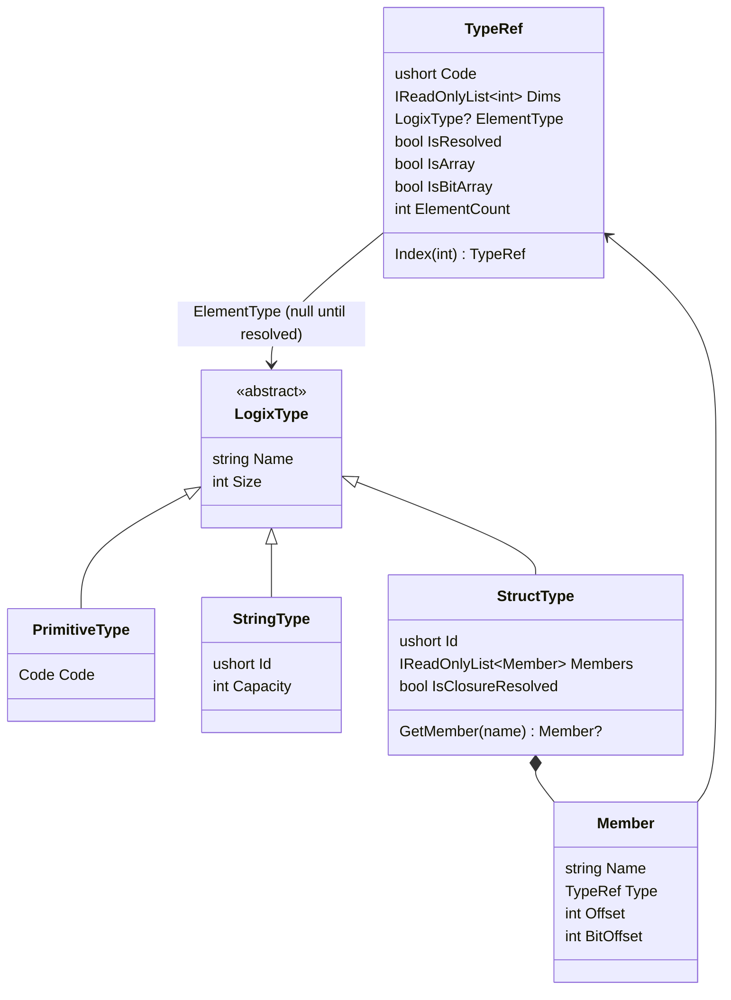
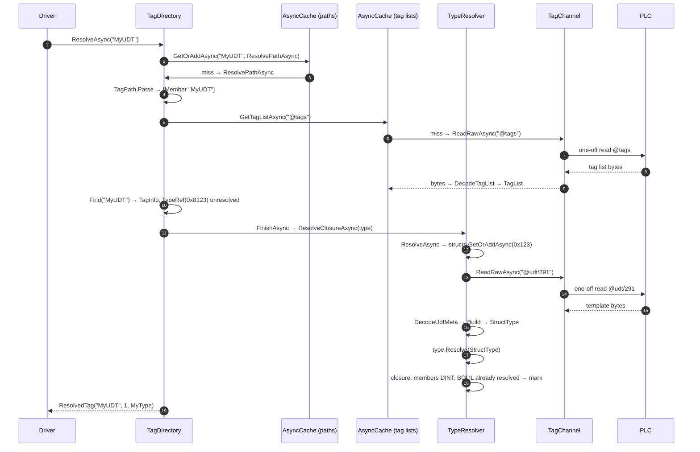

# 1. Type Resolution

[← Index](README.md) · Next: [Reading Tags →](02-reading-tags.md)

Type resolution turns a path string into a [`ResolvedTag`](../LogixDriver/Tags/TagDirectory.cs):

```csharp
public sealed record ResolvedTag(
    string NativeName,       // what to ask libplctag for, e.g. "MyUDT", "Grid[2,0]"
    int ElementCount,        // how many elements to request (32-bit words for BOOL arrays)
    TypeRef Type,            // what the read returns; its closure is resolved
    int BitOffset = 0,       // BOOL array element: its bit within the word
    bool IsBitArrayElement = false);  // writes must read-modify-write the word
```

Resolution reads only the metadata a path needs:

- the controller tag list (`@tags`), and a program's tag list if the path starts in that program
- the template (`@udt/{id}`) of each structure the path passes through
- every template inside the target's own type

All of it is cached, so each piece is read at most once per driver, or until `Refresh()`.

---

## The type model

Defined in [`Tags/Types/LogixType.cs`](../LogixDriver/Tags/Types/LogixType.cs).



The model splits each type into two parts:

- **`LogixType` is shared and immutable.** Every tag and member of UDT `MyType` points at the same `StructType` instance, built once from the template.
- **`TypeRef` is per use.** It holds the array dimensions and the type code. Its `ElementType` starts out `null` for structures. Primitives are filled in by the constructor (`PrimitiveType.For(code)`). When the template is read, `TypeRef.Resolve` sets the element type once with `Interlocked.CompareExchange`, and it never changes after that.

`TypeRef` is shared too. The `TypeRef` on a `TagInfo` is the same object resolution writes into, so resolving a path for a read also makes that tag browsable through `GetLoadedTags()`.

### Type codes

From [`TagMetaHelpers`](../LogixDriver/Tags/Meta/TagMetaHelpers.cs):

| Bits | Mask | Meaning |
|------|------|---------|
| 15 | `0x8000` | structure: the low 12 bits are the template id |
| 13–14 | `0x6000` | array; the value is the number of dimensions (`0x2000` = 1, `0x4000` = 2, `0x6000` = 3) |
| 12 | `0x1000` | system type, which is skipped in tag lists |
| 0–11 | `0x0FFF` | template id (structures) or atomic code (`0xC1` BOOL, `0xC4` DINT, ...) |

Examples:

| Declaration | Raw code | `TypeRef` after `FromRaw` |
|-------------|----------|---------------------------|
| `DINT` | `0x00C4` | `Code=0xC4, Dims=[]`, resolved immediately |
| `MyType` (template 0x123) | `0x8123` | `Code=0x8123, Dims=[]`, **unresolved** |
| `DINT[10]` | `0x20C4`, dims `[10,0,0]` | `Code=0xC4, Dims=[10]` |
| `DINT[4,5]` | `0x40C4`, dims `[4,5,0]` | `Code=0xC4, Dims=[4,5]` |
| `MyType[5]` | `0xA123`, dims `[5,0,0]` | `Code=0x8123, Dims=[5]`, unresolved |
| `BOOL[64]` | `0x20D3`, dims `[2,0,0]` | `Code=0xC1 (BOOL), Dims=[64]` |

BOOL arrays get special handling. Logix reports them as arrays of `0xD3`, a 32-bit DWORD, with dimensions counted in **words**. `TypeRef.FromRaw` normalizes them to `BOOL[words × 32]`, so the rest of the driver works in bits. The read and write paths convert back to word addressing; see [Reading → BOOL arrays](02-reading-tags.md#d-bool-array-flags-bool64).

---

## Worked example: `MyUDT`

Controller-scope tag `MyUDT` of type `MyType` (template id `0x123`):

```
MyType
├── nTest : DINT   (byte 0)
└── bTest : BOOL   (byte 4, bit 0)
size = 8 bytes
```



### Step 1: Path cache

`TagDirectory.ResolveAsync` looks the path up in the `resolved` [`AsyncCache`](../LogixDriver/Tags/AsyncCache.cs), which ignores case. On a miss it runs `ResolvePathAsync`.

- Concurrent callers for the same path share one `Lazy<Task>`.
- A failed or cancelled resolve is removed from the cache, so the next caller retries it.
- Paths are cached as spelled (ignoring case), so `MyUDT[1]` and `MyUDT[ 1 ]` are separate cache entries. Both resolve to the same `ResolvedTag` values.

### Step 2: Parse

`TagPath.Parse` splits the path into segments, each either a member name or one index group:

| Path | Segments |
|------|----------|
| `MyUDT` | `MyUDT` |
| `MyUDT.bTest` | `MyUDT`, `bTest` |
| `Recipes[3].Temp` | `Recipes`, `[3]`, `Temp` |
| `Grid[1,2]` or `Grid[1][2]` | `Grid`, `[1,2]` (adjacent groups merge) |
| `Program:Main.Speed` | `Program:Main`, `Speed` |

### Step 3: Root lookup

The root is either a controller tag or `Program:X` followed by one of that program's tags.

**Controller tag** (our case). The code calls `GetTagListAsync("@tags")`, which is cached per scope:

1. `TagChannel.ReadRawAsync("@tags")` runs `RunOnceAsync`. It creates a one-off native tag, waits for a *normal*-priority limiter slot, initializes the tag, reads it, copies the buffer and disposes the tag.
2. [`TagMetaDecoder.DecodeTagList`](../LogixDriver/Tags/Meta/TagMetaDecoder.cs) walks the entries. Each one has a 22-byte header (instance id, type, element length, three dims) followed by the name. `MyUDT` decodes to `TagListEntry("MyUDT", 0x8123, [0,0,0])`.
3. The `TagList` constructor sorts the entries:
   - names starting with `Program:` become `ProgramInfo` (not loaded yet)
   - system types (`0x1000`) are dropped
   - everything else becomes `TagInfo(Name, Path, TypeRef.FromRaw(type, dims))`
4. `Find("MyUDT")` matches the name ignoring case. The native name is built from **`root.Name`**, the controller's own spelling, not the caller's.

**Program tag.** For a path like `Program:Main.Speed`:

1. `GetProgramTagListAsync` reads the controller list first and takes the program's canonical name from it.
2. It then reads `Program:Main.@tags`, also cached per scope.
3. The native name becomes `Program:Main.Speed`.

### Step 4: Walk the segments

`MyUDT` has a single segment, so the loop does nothing. For longer paths each segment goes through the loop in `ResolvePathAsync`:

| Segment | Current type | What happens |
|---------|--------------|--------------|
| member `X` | scalar structure | `types.ResolveAsync(type)` fetches **only this template**, then `GetMember(X)` (ignoring case). Appends `.X` using the template's spelling; `type = member.Type`. |
| member `X` | array | Error: "member access on an array; index it first". |
| member `X` | non-structure | `KeyNotFoundException`: "has no members". |
| `[i,j]` with all dims | array | Bounds-checks the indices, appends `[i,j]`, `type = type.Index(n)` (now scalar). |
| `[i]` with fewer dims | multi-dim array | Selects a sub-array. Must be the last segment. Returns early; see [Reading → sub-array](02-reading-tags.md#c-sub-array-grid2). |
| `[i]` | BOOL array | Word addressing: appends `[i / 32]`, returns early with `BitOffset = i % 32`. Must be the last segment. |
| `[i]` | non-array | Error: "is not an array". |

### Step 5: Finish

The loop has ended with `type = MyType` (scalar), so the code calls `FinishAsync("MyUDT", type, elementCount: 1)`. If `type` were still an array (a whole-array read), the code would first append `[0]` for every dimension and set the element count to the array's element count, or its word count for BOOL arrays.

`FinishAsync` calls `TypeResolver.ResolveClosureAsync(type)`, because decoding or encoding a value needs every type it contains.

### Step 6: Template fetch and build

In [`TypeResolver`](../LogixDriver/Tags/Types/TypeResolver.cs):

1. **`ResolveAsync`**: `ElementType` is null, so it calls `structs.GetOrAddAsync(GetUdtId(0x8123) = 0x123, FetchAsync)`. This cache is keyed by template id, so every tag of `MyType` shares one read.
2. **`FetchAsync`** calls `ReadRawAsync("@udt/291")`. libplctag's `@udt/` takes the id in decimal.
3. **`DecodeUdtMeta`** parses the template:
   ```
   header (14 bytes): id, member-desc size, instance size (8), member count (3), handle
   members (8 bytes each): info (2), type (2), offset (4)
   names: "MyType;n…\0" "ZZZZZZZZZZMyType1\0" "nTest\0" "bTest\0" ...
   ```
   It finds three members, not two:

   | Name | Type | Offset | Info |
   |------|------|--------|------|
   | `nTest` | DINT | 0 | 0 |
   | `ZZZZZZZZZZMyType1` | SINT | 4 | 0 (hidden BOOL host byte) |
   | `bTest` | BOOL | 4 | 0 (bit number) |

   (The member order shown is illustrative.)
4. **`Build`** filters and converts the members:
   - **Hidden BOOL hosts are dropped.** Any SINT at the same offset as a BOOL member is storage, not a value. If it were exposed, writing back a stale host byte would overwrite every BOOL packed into it.
   - Each remaining member becomes `Member(Name, TypeRef.FromRaw(type, isArray ? [info] : []), Offset, BitOffset: isBool ? info : 0)`. For array members, `info` is the element count. BOOL array members are normalized from words to bits the same way as tags.
   - **String detection.** A structure with exactly two members, `DINT LEN` followed by `SINT[n] DATA`, becomes `StringType(Capacity: n)`. This covers `STRING` and user-defined string types. Everything else becomes `StructType`.
5. `type.Resolve(structType)` sets the shared `TypeRef`.

### Step 7: Closure

`ResolveClosureAsync` recurses into each member's `TypeRef`, all at once with `Task.WhenAll`. Each structure's closure is run once, deduplicated by the `closures` cache keyed by template id. When it finishes, `MarkClosureResolved()` sets a flag so later checks return immediately. Here `nTest` and `bTest` are primitives that were resolved at construction, so the closure completes without further reads.

For a member of another UDT type, this is where its `@udt/{id}` read would happen, recursively, with sibling templates fetched concurrently.

### Result

```
ResolvedTag(NativeName: "MyUDT", ElementCount: 1, Type: TypeRef → StructType "MyType")
```

Controller traffic: **`@tags` + `@udt/291`**. After that, resolving `MyUDT` costs nothing, and resolving any other `MyType` tag costs nothing beyond the tag list, which is already cached.

---

## Other resolution examples

| Path | Declared | NativeName | ElementCount | Type | BitOffset |
|------|----------|------------|--------------|------|-----------|
| `MyUDT` | `MyType` | `MyUDT` | 1 | `MyType` | 0 |
| `MyUDT.nTest` | — | `MyUDT.nTest` | 1 | `DINT` | 0 |
| `MyUDT.bTest` | — | `MyUDT.bTest` | 1 | `BOOL` | 0 ¹ |
| `MyArr` | `DINT[10]` | `MyArr[0]` | 10 | `DINT[10]` | 0 |
| `MyArr[3]` | — | `MyArr[3]` | 1 | `DINT` | 0 |
| `Grid` | `DINT[4,5]` | `Grid[0,0]` | 20 | `DINT[4,5]` | 0 |
| `Grid[2]` | — | `Grid[2,0]` | 5 | `DINT[5]` | 0 |
| `Grid[2,3]` | — | `Grid[2,3]` | 1 | `DINT` | 0 |
| `Recipes[3].Temp` | `Recipe[10]` | `Recipes[3].Temp` | 1 | `REAL` | 0 |
| `Flags` | `BOOL[64]` | `Flags[0]` | 2 (words) | `BOOL[64]` | 0 |
| `Flags[37]` | — | `Flags[1]` | 1 (word) | `BOOL` | 5 ² |
| `Program:Main.Speed` | `REAL` | `Program:Main.Speed` | 1 | `REAL` | 0 |

¹ A BOOL **member** is addressed by name. The controller finds the bit itself, so the template's bit number (`Member.BitOffset`) only matters when decoding a whole-structure buffer.
² The result also has `IsBitArrayElement = true`.

---

## Browsing: `LoadAsync`

`Driver.LoadTagsAsync(filter)` calls `TagDirectory.LoadAsync`, which uses the same caches:

- **No filter (null or empty):** reads `@tags`, runs `ResolveClosureAsync` on every controller tag, and loads every program by reading its tag list and resolving the closure of each of its tags.
- **Filter entries:**
  - A bare program name (`Program:HMI_A`) loads that whole program.
  - Anything else goes through `ResolveAsync(path)`. This resolves only that path's closure, and caches the path so later reads skip resolution.

`GetLoadedTags()` builds a snapshot of the controller list, filling in each `ProgramInfo.Tags` once that program's list has been read. A `TypeRef` with `IsResolved == false` belongs to a type that hasn't been fetched yet.

`Refresh()` clears the tag-list, path, template and closure caches, for use after a program download. It does **not** close open native tag sessions; see [Concurrency & Caching](05-concurrency-and-caching.md#caches).
