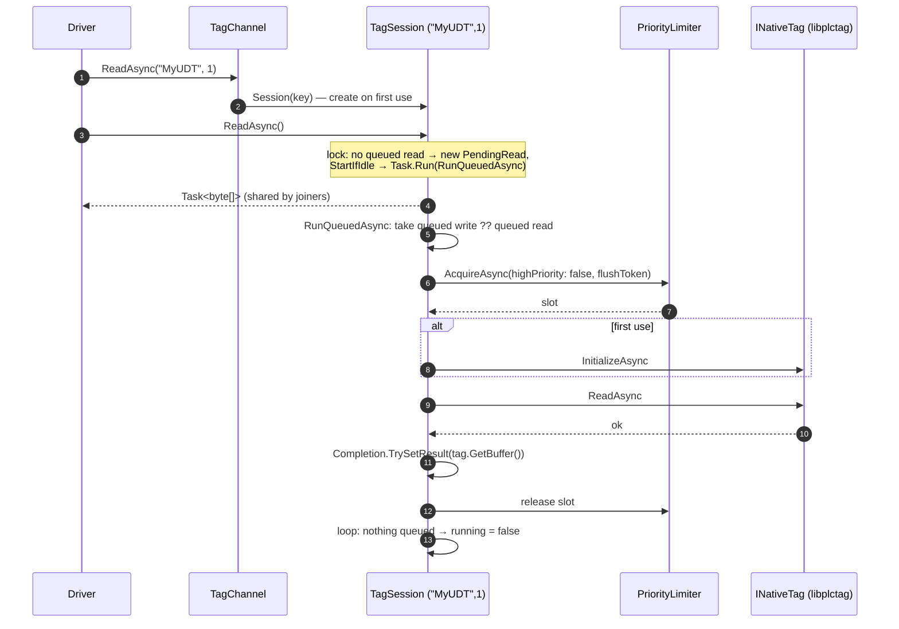

# 2. Reading Tags

[← Type Resolution](01-type-resolution.md) · [Index](README.md) · Next: [Writing Tags →](03-writing-tags.md)

Every read goes through [`Driver.ReadTagValueAsync`](../LogixDriver/Driver/Driver.cs) in three steps:

```csharp
var resolved = await Tags.ResolveAsync(tagName);                                   // 1. resolve
var buffer   = await channel.ReadAsync(resolved.NativeName, resolved.ElementCount); // 2. transfer
return valueResolver.ResolveValue(buffer, resolved.Type, 0, resolved.BitOffset);   // 3. convert
```

Step 1 is covered in [Type Resolution](01-type-resolution.md). This page covers steps 2 and 3, then works through structure, array, multi-dimensional, BOOL-array and string reads.

---

## Gate and error policy

Before any of this, `ReadTagValueAsync` checks `IsConnected`. If the driver is disconnected it returns `null` immediately and sends nothing to the controller.

All three steps share one `try`. The full table is in [Errors & Extensibility](06-errors-and-extensibility.md); in short:

| Outcome | Caller sees |
|---------|-------------|
| Success | the value |
| `OperationCanceledException` (flushed on connection loss, or disposed) | `null` |
| `NativeTagException` with `IsConnectionError` | `null`, and the monitor is asked to probe |
| Anything else (unknown tag, bad index, tag-level error such as NotFound) | the exception propagates |

---

## Step 2: Transfer



### Session lookup

`TagChannel.Session(nativeName, elementCount)` returns the [`TagSession`](../LogixDriver/Tags/Channel/TagSession.cs) for the key `("MyUDT", 1)`, creating it on first use.

- The dictionary holds a `Lazy<TagSession>`, so concurrent first callers create exactly one native tag.
- The session wraps `tagFactory.Create(name, count)`, which is a `LibPlcTag` around a libplctag `Tag` configured from `Target`: gateway, path, PLC type, `ab_eip`, timeout.
- Creating the tag does no I/O. Initialization happens on the first operation.

### Queueing and joining

`TagSession.ReadAsync` runs under the session lock:

- If **no read is queued**, it creates a `PendingRead` that captures the channel's current flush token. If the session is idle, it also starts the run loop with `Task.Run`, which keeps the loop off the caller's thread and outside the lock.
- If **a read is already queued**, the caller joins it and gets the same `Task<byte[]>`.

So any number of concurrent reads of one tag collapse into one controller read.

A read that is already *running* doesn't accept joiners. A read that arrives during it queues the next read, which sees fresher data.

### Running

`RunQueuedAsync` loops. Each pass takes the queued **write first**, otherwise the queued read, and runs it with `RunAsync`:

1. **Slot:** `Limiter.AcquireAsync(highPriority: false, operation.FlushToken)`. Reads use the normal-priority queue. If the connection is lost while the read waits here, the flush cancels it.
2. **Initialize** if this handle hasn't been used yet.
3. **Read:** `channel.RunNativeAsync(tag, tag.ReadAsync)`. On success this updates `LastActivityAt`, which feeds the heartbeat. On failure it wraps the error in `NativeTagException(name, status, inner)`.
4. **Complete:** `TrySetResult(tag.GetBuffer())` hands back a **copy** of the tag's buffer. Every joined reader gets that same array, which is why value resolvers must not modify it.
5. The slot is released when `using` ends, and the loop moves on to the next queued item, or goes idle.

Once the native operation has started, it runs to completion. Only libplctag's tag timeout (`Target.TimeoutMs`) limits it.

---

## Step 3: Convert

[`DefaultTagValueResolver.ResolveValue`](../LogixDriver/Tags/Value/TagValueResolver.cs) is a recursive walk over the `TypeRef`, carrying a byte `offset` and a `bitOffset`:

```
ResolveValue(buffer, type, offset, bitOffset)
├── type.IsArray        → List<object> over Elements(type, offset, bitOffset)
└── Resolved(type) is
    ├── PrimitiveType   → ReadPrimitive  (bool, sbyte, byte, short, ushort, int, uint, long, ulong, float, double)
    ├── StringType      → ReadString     (string)
    └── StructType      → Dictionary<string, object> { m.Name → ResolveValue(buffer, m.Type, offset + m.Offset, m.BitOffset) }
```

### Primitive mapping

| Logix | .NET | Read as |
|-------|------|---------|
| BOOL | `bool` | `(buffer[offset + bit/8] & (1 << bit%8)) != 0` |
| SINT / USINT | `sbyte` / `byte` | 1 byte |
| INT / UINT | `short` / `ushort` | little-endian |
| DINT / UDINT | `int` / `uint` | little-endian |
| LINT / ULINT | `long` / `ulong` | little-endian |
| REAL / LREAL | `float` / `double` | little-endian IEEE-754 |
| TIME | `int` | as DINT |
| DATE_AND_TIME | `long` | as LINT |
| anything else | — | `NotSupportedException` (a placeholder `PrimitiveType` with size 0) |

### Array elements

`TagValueResolverBase.Elements(array, offset, bitOffset)` yields one entry per index of the **first** dimension. All positions are computed in bits:

```
element     = array.Index(1)                         // remaining dims, or scalar
elementBits = array.IsBitArray ? 1 : elementType.Size * 8
strideBits  = elementBits * element.ElementCount
position(i) = offset*8 + bitOffset + i*strideBits    → (byte = position/8, bit = position%8)
```

Multi-dimensional arrays come out as nested lists, because each element is itself an array of the remaining dimensions. For structures, `Size` is the template's instance size, which already includes padding. So `Size` is also the correct stride for arrays of structures.

---

## Worked examples

### A. Structure: `MyUDT`

`MyType { nTest : DINT @0; bTest : BOOL @4.0 }`, size 8.

| | |
|-|-|
| ResolvedTag | `("MyUDT", 1, MyType)` |
| Session | `("MyUDT", 1)` |
| Buffer | `2A 00 00 00 01 00 00 00` |

```
ResolveValue(buf, MyType, 0, 0)               → StructType
├── nTest: ResolveValue(buf, DINT, 0+0, 0)    → ReadInt32LE(buf[0..])        = 42
└── bTest: ResolveValue(buf, BOOL, 0+4, 0)    → (buf[4] & 0b1) != 0          = true
```

**Result:** `Dictionary<string, object> { ["nTest"] = 42, ["bTest"] = true }`

The keys use the template's spelling. The dictionary is a plain `Dictionary` with the default comparer, so key lookups are case-sensitive.

#### Member variant: `MyUDT.bTest`

| | |
|-|-|
| ResolvedTag | `("MyUDT.bTest", 1, BOOL, BitOffset: 0)` |
| Session | `("MyUDT.bTest", 1)`, separate from `MyUDT`'s |
| Buffer | the BOOL's byte as the controller returns it |

`ReadPrimitive(BOOL, offset 0, bit 0)` gives `true` or `false`. The controller resolves the member path, so the template's bit position isn't used here.

### B. Array: `MyArr` (`DINT[10]`)

**Resolution.** `@tags` reports type `0x20C4` with dims `[10,0,0]`, so `TypeRef(DINT, [10])`. The `TypeRef` is an array with no index segments, so the code appends `[0]` and sets the count to `ElementCount = 10`. `ResolveClosureAsync` returns immediately, because DINT is a primitive and needs no template read.

| | |
|-|-|
| ResolvedTag | `("MyArr[0]", 10, DINT[10])` |
| Session | `("MyArr[0]", 10)` |
| Buffer | 40 bytes |

```
ResolveValue(buf, DINT[10], 0, 0)       → IsArray
Elements: element = DINT, elementBits = 32, stride = 32
  i=0 → (0,0)  i=1 → (4,0)  ...  i=9 → (36,0)
→ [ ReadInt32LE(buf[0..]), ReadInt32LE(buf[4..]), ... ]
```

**Result:** `List<object> { 0, 1, 2, ..., 9 }` (boxed `int`s)

#### Single element: `MyArr[3]`

The index segment is bounds-checked against `[10]`, and `type.Index(1)` leaves a scalar DINT. ResolvedTag is `("MyArr[3]", 1, DINT)`, the buffer is 4 bytes, and the result is a single `int`. This uses its own session, `("MyArr[3]", 1)`.

### C. Sub-array: `Grid[2]`

`Grid` is `DINT[4,5]`, reported as raw `0x40C4` with dims `[4,5,0]`, so `TypeRef(DINT, [4,5])`.

**Resolution.** One index for two dims is a partial index. `subArray = type.Index(1) = DINT[5]`, and the indices are padded with zeros for the remaining dims, giving `[2,0]`.

| | |
|-|-|
| ResolvedTag | `("Grid[2,0]", 5, DINT[5])` |
| Buffer | 20 bytes |
| Result | `List<object>` with 5 `int`s |

**Whole `Grid`:** `("Grid[0,0]", 20, DINT[4,5])` and an 80-byte buffer. In `Elements`, `element = DINT[5]` and `stride = 32 × 5 = 160 bits = 20 bytes`. Each row decodes recursively, giving `List<List<int>>` (as `List<object>` of `List<object>`).

A partial index must be the **last** segment. `Grid[2].X` is rejected; index every dimension before going further.

### D. BOOL array: `Flags` (`BOOL[64]`)

**Resolution.** `@tags` reports `0x20D3` (DWORD array) with dims `[2,0,0]`, counted in **words**. `TypeRef.FromRaw` normalizes this to `TypeRef(BOOL, [64])`. For a whole-array read the element count is converted back to words: `64 / 32 = 2`.

| | |
|-|-|
| ResolvedTag | `("Flags[0]", 2, BOOL[64])` |
| Buffer | 8 bytes (two little-endian DWORDs) |

```
Elements: IsBitArray → elementBits = 1, stride = 1
  i → (byte i/8, bit i%8)
→ [ (buf[0] & 1) != 0, (buf[0] & 2) != 0, ..., (buf[7] & 0x80) != 0 ]
```

**Result:** `List<object>` of 64 `bool`s. Because the DWORDs are little-endian, bit `i` of the array really is bit `i % 8` of byte `i / 8`.

### E. BOOL array element: `Flags[37]`

**Resolution.** In the bit-array branch of the index handling:
- word = `37 / 32 = 1`, so the native name is `Flags[1]`
- bit = `37 % 32 = 5`

| | |
|-|-|
| ResolvedTag | `("Flags[1]", 1, BOOL, BitOffset: 5, IsBitArrayElement: true)` |
| Session | `("Flags[1]", 1)`, **shared by `Flags[32]` … `Flags[63]`** |
| Buffer | 4 bytes (one word) |

`ResolveValue(buf, BOOL, 0, bitOffset: 5)` evaluates `(buf[0 + 5/8] & (1 << 5%8)) != 0`.

All 32 bits of a word map to one session. So polling every bit of `Flags[32..63]` at once costs **one** controller read; the others join it. Indexing past the bit is rejected (`Flags[37].X`), because a BOOL has no members.

### F. Array of structures: `Recipes` (`Recipe[10]`)

`Recipe` has template id `0x050` and size 12: `{ Id : DINT @0; Temp : REAL @4; Enabled : BOOL @8.0 }`.

**Resolution.** Raw `0xA050` with dims `[10,0,0]` gives `TypeRef(0x8050, [10])`. `FinishAsync` resolves the closure, which fetches `@udt/80` once for all ten elements. ResolvedTag is `("Recipes[0]", 10, Recipe[10])`, with a 120-byte buffer.

`Elements` gives `elementBits = 12 × 8 = 96`, so the offsets are 0, 12, 24, …. Each element decodes as a structure.

**Result:** `List<object>` of 10 `Dictionary<string, object>`.

**`Recipes[3].Temp`:** `[3]` is a full index, which leaves a scalar `Recipe`. `.Temp` then needs the template, which `types.ResolveAsync` fetches if it isn't cached. ResolvedTag is `("Recipes[3].Temp", 1, REAL)` and the result is a `float`.

### G. Strings

A template with exactly `LEN : DINT` followed by `DATA : SINT[n]` becomes `StringType(Capacity: n)`. For built-in `STRING`, n is 82 and the instance size is 88.

`ReadString` reads `LEN` at `offset`, clamps it to `[0, min(Capacity, bytes available)]`, and decodes that many bytes from `offset + 4` as **Latin-1**. Clamping means a corrupt or oversized `LEN` can't read past the buffer.

`STRING[5]` is an array of `StringType`, with each element `Size` bytes apart, so it decodes to a `List<object>` of `string`.

---

## Warm path

On the second and later reads of the same path:

| Step | Cost |
|------|------|
| `ResolveAsync` | path cache hit on a completed task; no I/O |
| `ReadAsync` | existing session, tag already initialized: **one** native read |
| `ResolveValue` | CPU only |

## Notes and caveats

- **Different spellings of one native tag share a session.** `MyUDT` and `myudt` both resolve to the controller's spelling. The cache key is the *native name* plus count.
- **Overlapping paths do not share.** `MyUDT` and `MyUDT.nTest` are separate native tags, and so are `MyArr` (`MyArr[0]`, 10) and `MyArr[0]` (`MyArr[0]`, 1). Reading both costs two controller requests.
- **Sessions are never evicted.** Every distinct `(native name, count)` keeps its libplctag handle until the driver is disposed.
- **Treat returned buffers as read-only.** A custom resolver receives the same array as every other reader that joined that read.
