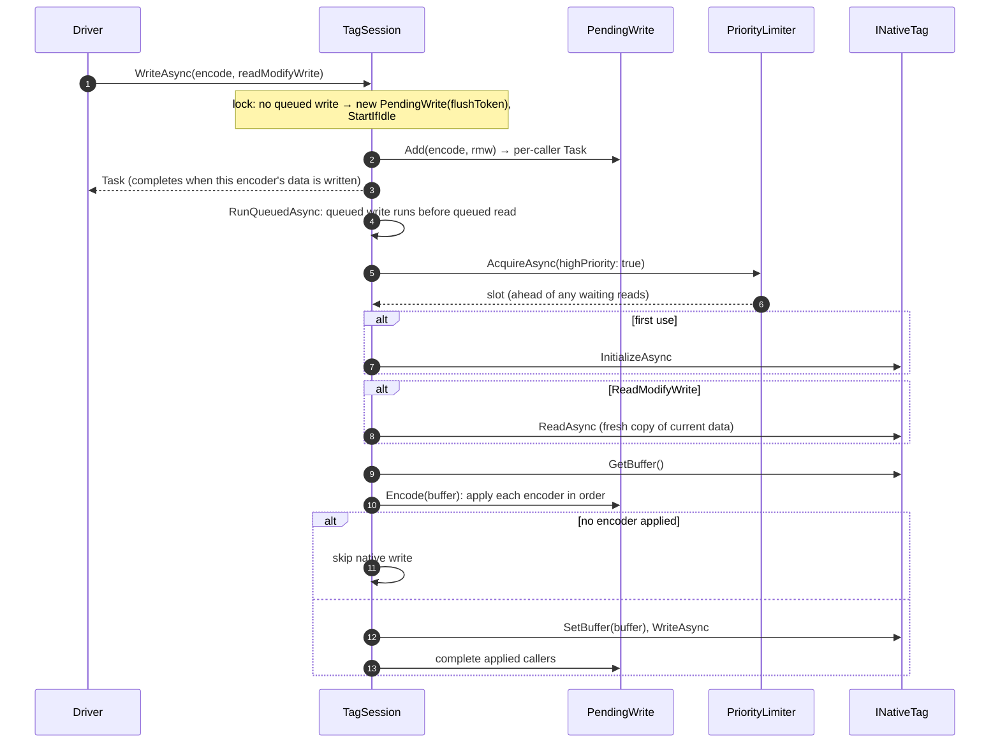
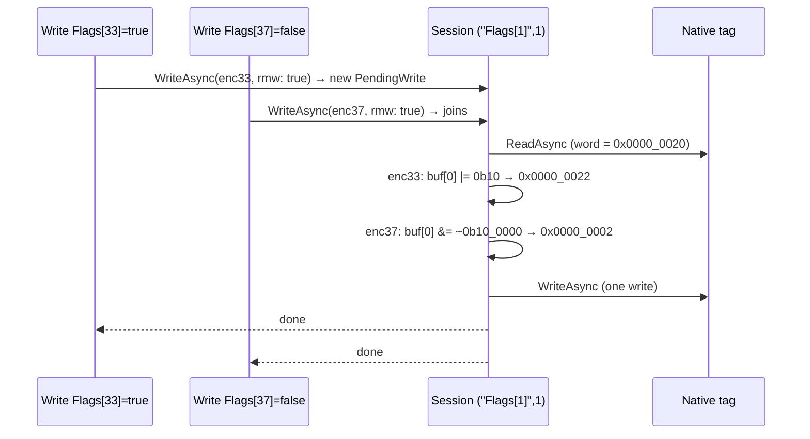

# 3. Writing Tags

[← Reading Tags](02-reading-tags.md) · [Index](README.md) · Next: [Connection Monitoring →](04-connection-monitoring.md)

A write uses the same resolution and the same per-tag session as a read. The difference is that the caller doesn't send bytes: it hands the session an **encoder**, a function that writes the value into a buffer. The session applies the encoder just before the native write.

[`Driver.WriteTagValueAsync`](../LogixDriver/Driver/Driver.cs):

```csharp
var resolved = await Tags.ResolveAsync(tagName);
await channel.WriteAsync(
    resolved.NativeName,
    resolved.ElementCount,
    buffer => valueResolver.WriteTagBuffer(buffer, resolved.Type, value, 0, resolved.BitOffset),
    readModifyWrite: resolved.IsBitArrayElement);
```

The encoder approach exists for two reasons:

1. **Coalescing.** Several writes to the same tag that are waiting at the same moment are applied one after another to one buffer and sent as **one** native write.
2. **Partial updates.** A BOOL-array element changes only one bit of a 32-bit word. The session reads the word first, every queued encoder flips its own bit, and the word is written back once.

---

## Gate and error policy

| Outcome | Caller sees |
|---------|-------------|
| `IsConnected == false` | **returns immediately, no exception** |
| Success | task completes |
| Encoder throws (wrong shape, missing member, overflow, bad string) | that exception, for **that caller only** |
| `OperationCanceledException` (flushed or disposed) | returns, no exception |
| `NativeTagException` with `IsConnectionError` | returns, no exception; monitor asked to probe |
| Other `NativeTagException` (e.g. NotFound, privilege) | exception propagates |

A write that hits a connection problem **fails silently**. If a caller has to know the value landed, it should check `IsConnected` or read the value back.

---

## The write pipeline



### `TagSession.WriteAsync`

In [`TagSession`](../LogixDriver/Tags/Channel/TagSession.cs), under the session lock:

- If no write is queued, it creates a `PendingWrite` holding the current flush token and starts the run loop if the session is idle.
- Either way, `PendingWrite.Add(encode, readModifyWrite)` appends the encoder, ORs the read-modify-write flag, and returns a **per-caller** completion task.

Callers that join one write each get their own task, so one caller can fail while the rest succeed.

### `RunAsync` for a write

1. **Slot at high priority.** Writes use the limiter's high queue, so they get the next free slot ahead of every waiting read. This includes metadata reads, which are normal priority.
2. **Initialize** the handle if needed.
3. **Read first** if any joined caller asked for read-modify-write.
4. `buffer = tag.GetBuffer()` takes a copy of the handle's current data: the read just done for read-modify-write, otherwise whatever the handle last held. Bytes the encoders don't touch keep these values, for example other bits of a word, padding, or BOOLs sharing a host byte.
5. **`PendingWrite.Encode(buffer)`** applies each encoder in arrival order. Before each one it checkpoints the buffer. If an encoder throws, the buffer is rolled back to the checkpoint, that caller's task fails, and the next encoder runs.
6. If **no** encoder succeeded, nothing is sent.
7. Otherwise `tag.SetBuffer(buffer)` runs (it resizes the native buffer if the length differs), then `tag.WriteAsync`, then every applied caller's task completes.
8. If a native operation fails, every caller's task receives the wrapped `NativeTagException`. Callers whose encoder already failed keep their original exception.

### Ordering guarantees

- **Within one session:** a queued write always runs before a queued read. A read requested after a write in the same session sees the written value.
- **Across sessions:** there is **no ordering**. `MyUDT.nTest` and `MyUDT` are different native tags with independent queues. If a write to one and a read of the other are started concurrently, they can complete in either order. Await the write before reading if order matters.

---

## Value → bytes

[`DefaultTagValueResolver.WriteTagBuffer`](../LogixDriver/Tags/Value/TagValueResolver.cs) mirrors `ResolveValue`:

```
WriteTagBuffer(buffer, type, value, offset, bitOffset)
├── type.IsArray      → value must be a non-string IEnumerable with exactly Dims[0] items;
│                       each item → WriteTagBuffer at its Elements() position
└── Resolved(type) is
    ├── PrimitiveType → WritePrimitive (Convert.ToXxx, little-endian)
    ├── StringType    → WriteString    (value must be string, ≤ Capacity)
    └── StructType    → for every member: value[m.Name] → WriteTagBuffer(offset + m.Offset, m.BitOffset)
```

### Accepted value shapes

| Target type | Accepted `value` |
|-------------|------------------|
| Primitive | anything `Convert.ToXxx` accepts: any boxed numeric, `bool`, numeric strings (`"42"`), `IConvertible` |
| BOOL | `Convert.ToBoolean`: `true`/`false`, non-zero numbers, `"true"`/`"False"` |
| String | `string` only |
| Array | any `IEnumerable` except `string`: `int[]`, `List<object>`, `List<int>`, nested sequences for multi-dim |
| Structure | `IDictionary<string, object>` (e.g. `Dictionary`, `ExpandoObject`) or non-generic `IDictionary` |

The `Convert` semantics carry through:

- Out-of-range values throw `OverflowException`; they never wrap silently. For example, writing `300` to a SINT throws.
- Floating-point to integer **rounds to nearest even**: `Convert.ToInt32(2.5) == 2` and `Convert.ToInt32(3.5) == 4`.
- Strings are encoded as Latin-1. Characters outside Latin-1 become `?`.

---

## Worked examples

### A. Whole structure: `MyUDT`

`MyType { nTest : DINT @0; bTest : BOOL @4.0 }`, size 8.

```csharp
await driver.WriteTagValueAsync("MyUDT", new Dictionary<string, object>
{
    ["nTest"] = 7,
    ["bTest"] = true,
});
```

| | |
|-|-|
| ResolvedTag | `("MyUDT", 1, MyType)`, `IsBitArrayElement = false` |
| Session | `("MyUDT", 1)`, the **same** session as reads of `MyUDT` |
| Read-modify-write | no |

Encoding into the handle's current 8-byte buffer:

```
StructType MyType, for each member:
  nTest → TryGetMemberValue("nTest") = 7     → WriteInt32LE(buf[0..], Convert.ToInt32(7))
  bTest → TryGetMemberValue("bTest") = true  → buf[4] |= 0b0000_0001

before: 2A 00 00 00 | 00 | xx xx xx
after:  07 00 00 00 | 01 | xx xx xx      (xx = padding, unchanged)
```

Then `SetBuffer` and one native write of 8 bytes.

**Every member is required.** A structure write is all-or-nothing because the whole instance goes out in one write, and any member that wasn't supplied would be sent with whatever the buffer last held. A missing or `null` member throws `ArgumentException("... is missing member 'bTest'")` before anything is sent.

Member lookup uses **the caller's dictionary**. A plain `Dictionary<string, object>` is case-sensitive, so its keys must match the template's spelling (`nTest`, not `NTEST`). Pass `new Dictionary<string, object>(StringComparer.OrdinalIgnoreCase)` to relax that. A dictionary returned by `ReadTagValueAsync` is already spelled correctly, so read → modify → write works without changes.

Nested structures and arrays inside the structure take nested dictionaries and sequences, which are encoded recursively at `offset + m.Offset`.

### B. Structure member: `MyUDT.nTest`

```csharp
await driver.WriteTagValueAsync("MyUDT.nTest", 7);
```

| | |
|-|-|
| ResolvedTag | `("MyUDT.nTest", 1, DINT)` |
| Session | `("MyUDT.nTest", 1)`, separate from `MyUDT` |
| Buffer | 4 bytes → `07 00 00 00` |

Only `nTest` changes on the controller. This is the way to change one member without supplying the whole structure.

#### BOOL member: `MyUDT.bTest`

ResolvedTag is `("MyUDT.bTest", 1, BOOL, BitOffset: 0)`. The encoder sets or clears bit 0 of the 1-byte buffer.

Because the member is addressed by name, the controller applies the change to the right bit. Other BOOLs that share the hidden host byte are not touched, and no read-modify-write is needed.

### C. BOOL array element: `Flags[37]` (read-modify-write)

```csharp
await Task.WhenAll(
    driver.WriteTagValueAsync("Flags[33]", true),
    driver.WriteTagValueAsync("Flags[37]", false));
```

Both paths resolve to the same word:

| Path | ResolvedTag |
|------|-------------|
| `Flags[33]` | `("Flags[1]", 1, BOOL, BitOffset: 1, IsBitArrayElement: true)` |
| `Flags[37]` | `("Flags[1]", 1, BOOL, BitOffset: 5, IsBitArrayElement: true)` |

They share the session `("Flags[1]", 1)`. If the second call arrives while the first write is still queued, it joins the same `PendingWrite`:



`WritePrimitive` for BOOL handles `bitOffset >= 8`: the byte index is `offset + bitOffset / 8` and the mask is `1 << (bitOffset % 8)`. So bit 29 of the word lands in `buf[3]`, bit 5.

Read-modify-write prevents lost updates **among this driver's own writes**, because bits are coalesced inside one session. It **can't** prevent the controller's logic, or another client, from changing a different bit of the same word between the read and the write. That window is one round trip. If that matters, have different writers use different words.

### D. Whole array: `MyArr` (`DINT[10]`)

```csharp
await driver.WriteTagValueAsync("MyArr", new[] { 9, 8, 7, 6, 5, 4, 3, 2, 1, 0 });
```

| | |
|-|-|
| ResolvedTag | `("MyArr[0]", 10, DINT[10])` |
| Validation | non-string `IEnumerable`, exactly 10 items, else `ArgumentException` |
| Encoding | item `i` → `Elements()` position `i*4` → `WriteInt32LE` |

**Multi-dimensional** (`Grid`, `DINT[4,5]`): pass 4 sequences of 5 items each, such as `int[][]` or the nested `List<object>` from a read. A **sub-array** (`Grid[2]`) takes 5 items.

A **whole BOOL array** (`Flags`, `BOOL[64]`): pass 64 booleans. ResolvedTag is `("Flags[0]", 2, BOOL[64])`. No read-modify-write is needed, because every bit is written.

**Array of structures** (`Recipes`): pass 10 dictionaries, each with every member.

### E. String

`StringType` requires a `string` no longer than `Capacity`, otherwise it throws `ArgumentException`. `WriteString`:

1. clears the `DATA` area, so no stale characters are left after a shorter string
2. writes the Latin-1 bytes
3. sets `LEN` to the number of bytes written

---

## Coalescing semantics in one table

| Situation | Result |
|-----------|--------|
| Two whole-value writes to the same tag while one is still queued | Both encoders run in order on one buffer. **The last value wins**, one write is sent, and both callers succeed. The first value never reaches the controller. |
| A write arrives while a write on that tag is **running** | A new `PendingWrite` is queued and sent after the running one finishes. |
| Bit writes to different bits of the same BOOL-array word | Read once, apply every bit, write once. |
| One of several joined encoders throws | Its changes are rolled back and only its caller fails; the others are written. |
| Every joined encoder throws | No native write is sent. |
| Flush while waiting for a slot | Every joined caller is cancelled. The driver swallows this, so callers simply return. |
