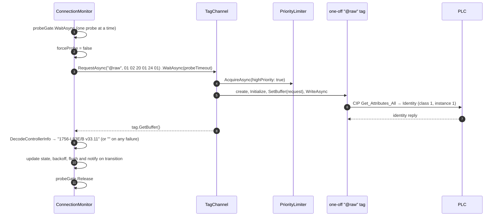
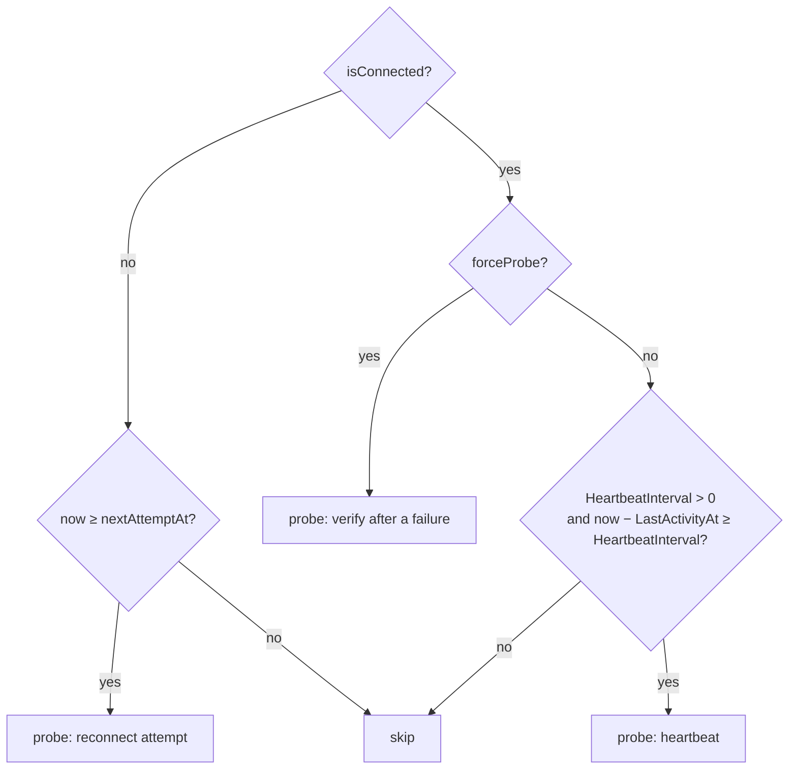
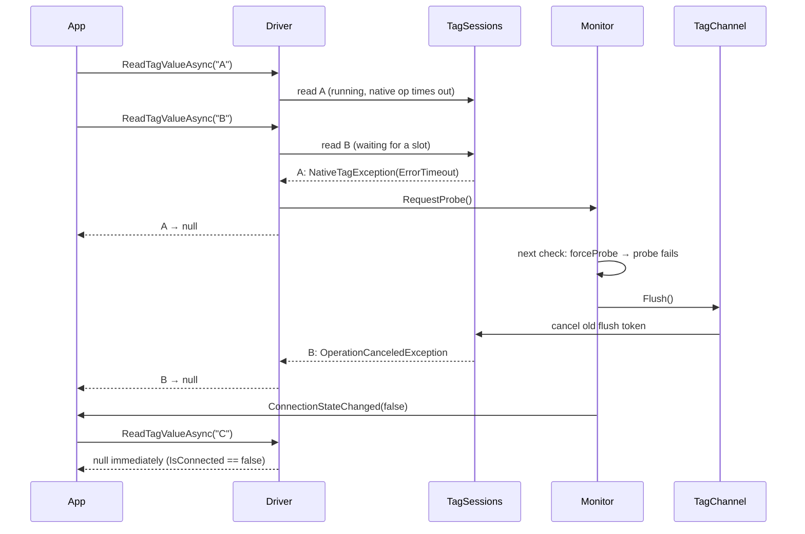

# 4. Connection Monitoring

[← Writing Tags](03-writing-tags.md) · [Index](README.md) · Next: [Concurrency & Caching →](05-concurrency-and-caching.md)

[`ConnectionMonitor`](../LogixDriver/Driver/ConnectionMonitor.cs) owns `Driver.IsConnected` and `Driver.ControllerInfo`. It is the **only** code that changes the connection state. It probes the controller when asked to, and, once started, in the background:

- **heartbeat** probes while connected and idle
- **reconnect** attempts with backoff while disconnected

Reads and writes never change the state themselves. When one hits a connection error it calls `RequestProbe()`, and the monitor decides.

---

## Construction

The monitor is created inside the `Driver` constructor:

```csharp
monitor = new ConnectionMonitor(
    target.HeartbeatInterval,                          // default TimeSpan.Zero = heartbeat off
    TimeSpan.FromMilliseconds(target.TimeoutMs * 2),   // probe timeout
    channel,
    connected => ConnectionStateChanged?.Invoke(this, new ConnectionStateChangedEventArgs(connected)));
```

| Setting | Source | Default | Purpose |
|---------|--------|---------|---------|
| Heartbeat interval | `Target.HeartbeatInterval` | `Zero` (off) | Idle time after which a connected driver probes |
| Probe timeout | `2 × Target.TimeoutMs` | 10 s | One timeout waiting behind in-flight operations for a slot, plus one for the probe itself |
| Check interval | constant | 250 ms | How often the background loop checks whether a probe is due |
| Reconnect backoff | constant | 2 s, 5 s, 10 s, then 10 s… | Delay before each reconnect attempt |

**Nothing runs until `TryConnect`/`TryConnectAsync` is called.** Starting the loop there, not in the constructor, gives callers time to subscribe to `ConnectionStateChanged` before any transition can happen.

---

## The probe



### Request

`ProbePayload = { 0x01, 0x02, 0x20, 0x01, 0x24, 0x01 }` is a raw CIP request:

| Bytes | Meaning |
|-------|---------|
| `01` | Service `Get_Attributes_All` |
| `02` | Request path is 2 words long |
| `20 01` | Logical segment: class `0x01` (Identity) |
| `24 01` | Logical segment: instance `1` |

`TagChannel.RequestAsync` sends it through `RunOnceAsync`, the same one-off path used for `@tags` and `@udt`, but with **high priority**. A probe therefore never waits behind a backlog of reads. It can still wait for a slot held by an operation that is already running, which is why the timeout is doubled.

### Reply

`TagMetaDecoder.DecodeControllerInfo` reads the Identity object reply:

```
offset  0  reply service, reserved, general status, ext status size   (4)
offset  4  vendor id (2), device type (2), product code (2)
offset 10  revision major (1)
offset 11  revision minor (1)
offset 12  status (2), serial number (4), name length (1)
offset 19  product name  → "1756-L83E/B"
```

The result is `"{name} v{major}.{minor}"`.

### Outcome

`ReadControllerInfoAsync` treats **any** exception as "not connected" and returns `""`: a timeout from `WaitAsync`, a `NativeTagException`, or a decode error. The one exception is cancellation of the monitor's own token, which is re-thrown so that dispose can stop a probe.

`WaitAsync(probeTimeout)` only stops the *wait*. The native operation it abandoned keeps its slot until libplctag's tag timeout expires.

### State update

All of this runs under `probeGate`:

```csharp
controllerInfo = info;                       // "" when disconnected
if (connected) failedAttempts = 0;
else {
    delay = ReconnectBackoff[min(failedAttempts, 2)];
    failedAttempts++;
    nextAttemptAt = now + delay;
}
if (connected != isConnected) {
    isConnected = connected;
    if (!connected) channel.Flush();         // cancel everything waiting to run
    NotifyStateChanged(connected);           // raise ConnectionStateChanged
}
```

`probeGate` is a `SemaphoreSlim(1,1)`. It serializes all probes, whether they come from `TryConnect`, the loop, or a request. That gives two guarantees:

- state transitions never interleave
- `ConnectionStateChanged` events are raised **in order**, one per actual transition

The event is raised **only on a transition**. A `TryConnect` that fails while already disconnected (for example, the first call against an unreachable controller) raises nothing and just returns `false`.

---

## The background loop

`RunLoopAsync` is started once by the first `ProbeNowAsync`, whatever that probe's result was. It runs until the driver is disposed:

```
every 250 ms:
    if IsProbeDue(): RunProbeAsync()
    exceptions (other than shutdown) are logged and the loop continues
```

`IsProbeDue()` makes the decision:



| State | What triggers a probe |
|-------|----------------------|
| **Disconnected** | The backoff schedule only. Attempts run 2 s, 5 s, 10 s, 10 s… after each failure. `forceProbe` is ignored. |
| **Connected** | `RequestProbe()` after a failed read or write, **or** heartbeat idle time. |

### Heartbeat and `LastActivityAt`

`TagChannel.LastActivityAt` is updated after **every** successful native operation: reads, writes, initializations, metadata reads, and the probe itself. The heartbeat therefore only fires when the driver has been *idle* for `HeartbeatInterval`. A busy driver proves it is connected through its own traffic and doesn't spend round trips on probes.

With the heartbeat **off** (the default), a connected driver that sends no traffic won't notice a dropped connection until its next read or write fails.

### `RequestProbe`

[`Driver.ReadTagValueAsync` and `WriteTagValueAsync`](../LogixDriver/Driver/Driver.cs) catch `NativeTagException` when `IsConnectionError` is true and call `monitor.RequestProbe()`. That sets `forceProbe = true`, and the next 250 ms check probes. `IsConnectionError` is true when:

- the tag status is `ErrorBadConnection`, `ErrorTimeout`, `ErrorWinsock` or `Pending`, **or**
- the inner exception message is `"ErrorTimeout"`. This has been observed to happen even when the tag status reports something unrelated, such as NotFound.

A single failed read doesn't mark the driver disconnected. Only a failed probe does, which keeps one bad tag (e.g. NotFound) from taking the connection down.

---

## Connection lost: what happens to in-flight work



1. **`TagChannel.Flush()`** swaps in a new `CancellationTokenSource` and cancels the old one. Every pending operation captured the old token when it was queued.
2. Operations **waiting for a limiter slot** are cancelled. `TagSession.RunAsync` catches the cancellation and cancels the operation, which cancels every joined caller. The driver turns that into `null` for reads and a silent return for writes.
3. Operations **already running** (holding a slot) aren't interrupted. They finish or fail on their own, limited by the tag timeout.
4. While `IsConnected == false`, `ReadTagValueAsync` returns `null` and `WriteTagValueAsync` returns without sending anything. The controller sees no traffic except the probes.
5. Operations queued **after** the flush capture the new token and aren't affected.

## Reconnect

On the next probe that's due, the backoff schedule allows it:

1. The probe succeeds: `failedAttempts` resets to 0, `isConnected` becomes true, `ControllerInfo` is refreshed, and `ConnectionStateChanged(true)` is raised.
2. Reads and writes go through again. The existing `TagSession`s and their libplctag handles are **reused**; libplctag re-establishes its own connection on the next operation.
3. **Metadata is not invalidated.** The tag-list, type and path caches survive the outage. If the controller program may have changed while the driver was disconnected (a download, or tags added or removed), call `driver.Tags.Refresh()` after reconnecting.

---

## Event handler rules

`ConnectionStateChanged` is raised **on the probe path, while `probeGate` is held**:

- **Return quickly.** The next probe, and any `TryConnect` call, waits for your handler to finish.
- **Never block on `TryConnect()` or `TryConnectAsync()` inside the handler.** Those wait on the same `probeGate`, so the probe path would wait on itself and deadlock. Fire-and-forget or post to another context instead.
- An exception thrown by the handler is caught and written to the console. It doesn't break monitoring.
- The handler runs on whatever thread is running the probe, usually a thread-pool thread. The driver uses `ConfigureAwait(false)` throughout, so don't assume a UI or other synchronization context. Marshal to it yourself.

---

## State timeline example

An application polls once a second with `HeartbeatInterval = 5 s`. The controller is unplugged, then plugged back in a while later:

| # | Event | IsConnected | Notes |
|---|-------|-------------|-------|
| 1 | `TryConnectAsync()` → probe OK | false → **true** | Event(true). Loop starts. |
| 2 | Polling reads succeed | true | Traffic keeps `LastActivityAt` fresh, so no heartbeat probes. |
| 3 | *Cable pulled.* A read fails after `TimeoutMs` | true | `RequestProbe()`; that read returns `null`. Reads queued behind it keep waiting. |
| 4 | Next 250 ms check: forced probe fails | true → **false** | `Flush()` cancels the waiting reads (they return `null`). Event(false). Next attempt in 2 s. |
| 5 | Reads from the app | false | Return `null` immediately with no traffic. |
| 6 | Attempt fails | false | Next attempt in 5 s |
| 7 | Attempt fails | false | Next in 10 s, and every 10 s after that |
| 8 | *Cable restored.* Next attempt succeeds | false → **true** | Event(true). Backoff resets. |
| 9 | Reads resume on the existing sessions | true | Consider `Tags.Refresh()` if the program may have changed. |

Each backoff delay is counted from when the failed probe *finished*. A failed probe can take up to the probe timeout to finish, so wall-clock gaps between attempts are longer than 2/5/10 s.

---

## Disposal

`Driver.Dispose()` disposes the monitor first, then the channel:

1. **Monitor:** marks itself disposed, so the loop can't start again. It then cancels the loop token, waits up to 2 s for the loop to exit, and disposes its token source and `probeGate`.
2. **Channel:** flushes, takes every limiter slot to wait out running operations (giving up after 5 s), then disposes every native tag. See [Concurrency & Caching → Disposal](05-concurrency-and-caching.md#disposal).
