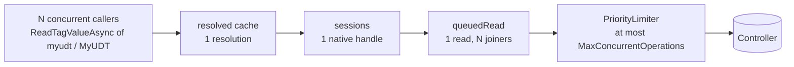
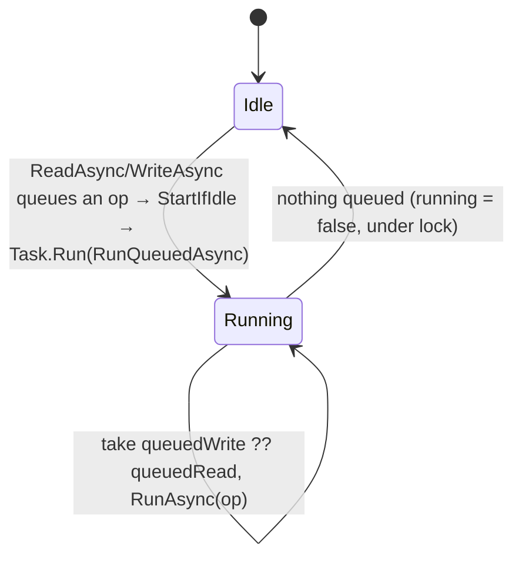

# 5. Concurrency & Caching

[← Connection Monitoring](04-connection-monitoring.md) · [Index](README.md) · Next: [Errors & Extensibility →](06-errors-and-extensibility.md)

The driver is built for many concurrent callers polling overlapping sets of tags, for example an HMI server that refreshes hundreds of symbols. Its job is to send the controller as few requests as possible and never break libplctag's rule of one operation per tag handle at a time. This page lists every place where work is deduplicated, serialized or prioritized.

---

## Layers of deduplication

| Layer | Key | Deduplicates | Lifetime |
|-------|-----|--------------|----------|
| `TagDirectory.tagLists` | scope (`@tags`, `Program:X.@tags`), ignoring case | tag-list reads | until `Refresh()` |
| `TagDirectory.resolved` | path string, ignoring case | whole path resolutions | until `Refresh()` |
| `TypeResolver.structs` | template id | `@udt/{id}` reads and building `StructType` | until `Refresh()` |
| `TypeResolver.closures` | template id | recursive closure walks | until `Refresh()` |
| `TagChannel.sessions` | `(native name, element count)` | native tag handles (one per key) | until `Dispose()` |
| `TagSession.queuedRead` | per session | concurrent reads → one native read | until it runs |
| `TagSession.queuedWrite` | per session | concurrent writes → one native write | until it runs |



---

## Caches

### `AsyncCache<TKey, TValue>`

[`Tags/AsyncCache.cs`](../LogixDriver/Tags/AsyncCache.cs) is the primitive behind all four metadata caches:

```csharp
var entry = entries.GetOrAdd(key, k => new Lazy<Task<TValue>>(() => fetch(k)));
try { return await entry.Value; }
catch { entries.TryRemove(new(key, entry)); throw; }
```

- **One fetch per key.** `ConcurrentDictionary.GetOrAdd` may call its factory more than once under contention, but only one `Lazy` is stored, and only the stored `Lazy`'s fetch runs.
- **Failures aren't cached.** A faulted or cancelled fetch removes **its own** entry. The key-and-value comparison keeps it from evicting a newer entry another caller added in the meantime. Every caller that joined the failed fetch sees the same exception, and the next caller starts a new fetch.
- **`TryGet`** returns only values that completed successfully. It is used by `GetLoadedTags()` and `TypeResolver.TryGet`, and never waits.

### Template sharing and the `TypeRef` model

Every `TypeRef` with code `0x8123` across every tag and member resolves to the same `StructType`. Resolving one tag's type therefore makes its type available to all of them:

- `TypeRef.Resolve` sets `ElementType` with `Interlocked.CompareExchange(ref elementType, type, null)`. The first writer wins, and every writer is writing the same instance anyway.
- `StructType.IsClosureResolved` is a volatile flag that lets later closure checks skip the cache lookup.

### Sessions are never evicted

`TagChannel.sessions` grows with every distinct `(native name, count)` the application touches, and each entry holds a libplctag handle. That suits a fixed set of polled symbols. An application that reads a very large or ever-changing set of paths, such as arbitrary array indices, keeps all those handles until `Dispose()`.

`Tags.Refresh()` **doesn't** close sessions. That's fine as long as native names still mean the same thing after a program change. A tag that was deleted will fail with a tag-level error, which propagates to the caller.

---

## `TagSession`: one native handle, serialized

[`Tags/Channel/TagSession.cs`](../LogixDriver/Tags/Channel/TagSession.cs)



- Each session has at most **one queued read** and **one queued write**, plus at most one operation running.
- New requests **join** whatever is queued. A read shares the queued read's result. A write adds its encoder to the queued write; see [Writing → coalescing](03-writing-tags.md#coalescing-semantics-in-one-table).
- **A queued write goes before a queued read.**
- The `running` flag and both queue slots are changed only under `sync`. Each queued item is taken and cleared atomically, so a request arriving during `RunAsync` lands in a fresh queued item that the loop picks up next.
- `StartIfIdle` launches the loop with `Task.Run`, so the caller never runs native I/O inside the lock or on its own thread.
- Completions use `TaskCreationOptions.RunContinuationsAsynchronously`, so caller code never runs inline on the session's loop.

**Throughput:** a session runs one operation at a time, so a single heavily polled tag gets at most one read per round trip, no matter how many callers ask. Parallelism comes from having **many** sessions, limited by the `PriorityLimiter`.

---

## `PriorityLimiter`: global cap, writes first

[`Tags/Channel/PriorityLimiter.cs`](../LogixDriver/Tags/Channel/PriorityLimiter.cs)

A counting semaphore with two FIFO wait queues. Its capacity is `Target.MaxConcurrentOperations` (default **8**).

| Caller | Priority |
|--------|----------|
| Session write | **high** |
| Probe (`RequestAsync("@raw")`) | **high** |
| Session read | normal |
| Metadata read (`@tags`, `@udt/…` via `ReadRawAsync`) | normal |

- **Fast path:** if a slot is free and nobody is waiting, the slot is taken right away, without waiting or checking the token.
- **Slow path:** the caller queues a `TaskCompletionSource` in the high or normal queue and waits for it, with the cancellation token registered.
- **Release** hands the slot **directly** to the next waiter: all high-priority waiters first, then normal ones, FIFO within each queue. If nobody is waiting, the free count goes back up. Waiters that were cancelled stay in the queue until Release reaches them; their `TrySetResult` fails and Release moves on to the next waiter.
- If cancellation and a grant race, whichever `TrySet…` runs first wins. A waiter that was granted the slot keeps it and returns it normally when it is disposed.

Slots are held for the whole native operation, including initialization and the read in a read-modify-write. `MaxConcurrentOperations` is therefore the maximum number of requests in flight. A higher value lets libplctag pack more requests into each round trip, at the cost of more load on the controller's connection.

---

## Flush

`TagChannel.Flush()`:

```csharp
Interlocked.Exchange(ref flushSource, new CancellationTokenSource()).Cancel();
```

- Each pending session operation, and each one-off `RunOnceAsync`, **captures the current token when it is created** and passes it to `AcquireAsync`.
- Cancelling the old source cancels everything still **waiting in the limiter queues**. Operations already holding a slot run to completion, limited by the tag timeout.
- Anything created after the flush gets the new token and isn't affected.
- The old source isn't disposed, because operations may still be registered on its token.
- Callers who joined a cancelled operation see `OperationCanceledException`. `Driver` maps it to `null` for reads and a silent return for writes.

`Flush` is called by `ConnectionMonitor` when the connection goes from connected to disconnected, and by `TagChannel.Dispose`.

---

## Disposal

`TagChannel.Dispose()`:

1. Sets `disposed`. New `Session()` and `RunOnceAsync` calls throw `ObjectDisposedException`.
2. `Flush()` cancels everything that is waiting.
3. **Drains** by taking every limiter slot at high priority and never giving them back. This waits for all running native operations to finish. The wait gives up after **5 s**, so a stuck native call can't hang `Dispose`.
4. Disposes every native tag that was created, then clears the sessions.

`Driver.Dispose()` disposes the `ConnectionMonitor` first, so no probe starts during the drain, and then the channel.

---

## Threading and sync-over-async

- Every `await` in the library uses `ConfigureAwait(false)`. Library continuations never need the caller's synchronization context.
- The synchronous wrappers (`ReadTagValue`, `WriteTagValue`, `LoadTags`, `TryConnect`) are `...Async().GetAwaiter().GetResult()`. Thanks to `ConfigureAwait(false)` they don't deadlock on a UI or single-threaded context. They do **block** the calling thread for the whole operation, including any queueing behind other work.
- Never call `TryConnect()` synchronously from inside a `ConnectionStateChanged` handler; see [Connection Monitoring → Event handler rules](04-connection-monitoring.md#event-handler-rules).

---

## Request cost cheat sheet

| Operation | Cold (nothing cached) | Warm |
|-----------|-----------------------|------|
| Read `MyUDT` (flat UDT) | `@tags` + `@udt/{id}` + init + read | 1 read |
| Read `Recipes[3].Temp` | `@tags` + `@udt/{Recipe}` + nested templates + init + read | 1 read |
| Read a primitive tag | `@tags` + init + read | 1 read |
| 100 concurrent reads of one path | same as one read | 1 read (99 join) |
| 32 concurrent reads, one per bit of a BOOL word | one resolve per path + 1 init + 1 read | 1 read |
| Write a BOOL array bit | resolve + init + read + write | read + write |
| N joined bit writes to one word | resolve + init + read + write | read + write |
| `LoadTagsAsync()` with no filter | `@tags` + one `Program:X.@tags` per program + one `@udt` per distinct structure type | nothing (cached) |
