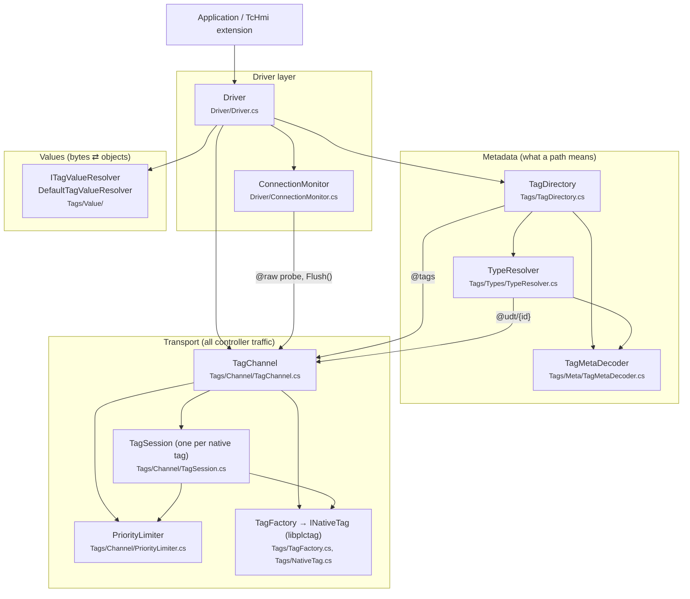

# LogixDriver Internals

How the driver turns a tag path like `"MyUDT"` or `"Program:Main.Recipes[3].Temp"` into a value, a write, or a connection-state change, traced through the code.

These pages are about how the driver works inside. For the public API, see the [repository README](../README.md).

| # | Document | Covers |
|---|----------|--------|
| 1 | [Type Resolution](01-type-resolution.md) | Tag lists, UDT templates, `TypeRef`/`LogixType`, path → `ResolvedTag` |
| 2 | [Reading Tags](02-reading-tags.md) | UDT, member, array, sub-array and BOOL-array reads; buffer → value |
| 3 | [Writing Tags](03-writing-tags.md) | Whole-structure, member and BOOL-bit writes; encoders, write coalescing, read-modify-write |
| 4 | [Connection Monitoring](04-connection-monitoring.md) | Probes, heartbeat, reconnect backoff, flush, state events |
| 5 | [Concurrency & Caching](05-concurrency-and-caching.md) | Every cache and queue, what each one deduplicates, priority and disposal |
| 6 | [Errors & Extensibility](06-errors-and-extensibility.md) | What fails where and what the caller sees; custom value resolvers; test seams |

---

## Architecture at a glance



Every operation goes through three stages:

1. **Resolve.** `TagDirectory.ResolveAsync(path)` returns a `ResolvedTag`: the native name to request, how many elements to request, the fully resolved `TypeRef`, and, for BOOL-array elements, a bit offset.
2. **Transfer.** `TagChannel.ReadAsync` or `WriteAsync` moves the raw bytes through a per-tag `TagSession`. A global `PriorityLimiter` caps how many operations are in flight at once.
3. **Convert.** `ITagValueResolver` turns bytes into a value (read) or a value into bytes (write), driven by the `TypeRef`.

`ConnectionMonitor` runs alongside these stages. It owns `IsConnected`, probes the controller, and flushes queued work when the connection drops.

## Glossary

| Term | Meaning |
|------|---------|
| **Native name** | The string handed to libplctag, in Logix syntax: `MyUDT`, `MyArr[0]`, `Grid[2,0]`, `Program:Main.Speed`. |
| **Element count** | How many elements libplctag requests, starting at the native name. For BOOL arrays this counts 32-bit words, not bits. |
| **`TypeRef`** | The type of one tag or member: a type code, array dimensions, and a lazily filled `ElementType`. Each tag and member has its own instance. |
| **`LogixType`** | A resolved, immutable, shared type: `PrimitiveType`, `StringType` or `StructType`. Exactly one instance exists per UDT template. |
| **Template** | The controller's description of a structure type, read from `@udt/{id}`. |
| **Closure** | A type plus every type it contains, recursively. Reading or writing a value requires its closure to be resolved. |
| **Session** | `TagSession`: owns one native libplctag handle, keyed by `(native name, element count)`, and serializes its operations. |
| **Slot** | Permission from `PriorityLimiter` to run one native operation. |
| **Flush** | Cancels every operation still waiting for a slot. Used when the connection is lost and on dispose. |

## Source map

```
LogixDriver/
├── Driver/
│   ├── Driver.cs              entry point: Read/Write/Load/TryConnect, error policy
│   ├── IDriver.cs             public contract
│   ├── ConnectionMonitor.cs   IsConnected, probes, heartbeat, backoff
│   └── Target.cs              gateway, path, timeouts, concurrency
└── Tags/
    ├── TagDirectory.cs        tag lists, path parsing (TagPath), path → ResolvedTag
    ├── AsyncCache.cs          shared get-or-add for async fetches
    ├── TagFactory.cs          creates native tags from a Target
    ├── NativeTag.cs           INativeTag, LibPlcTag, NativeTagException
    ├── Types/
    │   ├── LogixType.cs       LogixType, PrimitiveType, StringType, StructType, Member, TypeRef
    │   └── TypeResolver.cs    template fetch/build, closure resolution
    ├── Meta/
    │   ├── TagMetaDecoder.cs  @tags / @udt / identity byte layouts
    │   └── TagMetaHelpers.cs  type codes and flag masks
    ├── Value/
    │   ├── ITagValueResolver.cs
    │   └── TagValueResolver.cs  TagValueResolverBase<T>, DefaultTagValueResolver
    └── Channel/
        ├── TagChannel.cs      sessions, one-off reads, flush, dispose
        ├── TagSession.cs      per-tag read/write queue with coalescing
        └── PriorityLimiter.cs global concurrency cap, writes before reads
```
